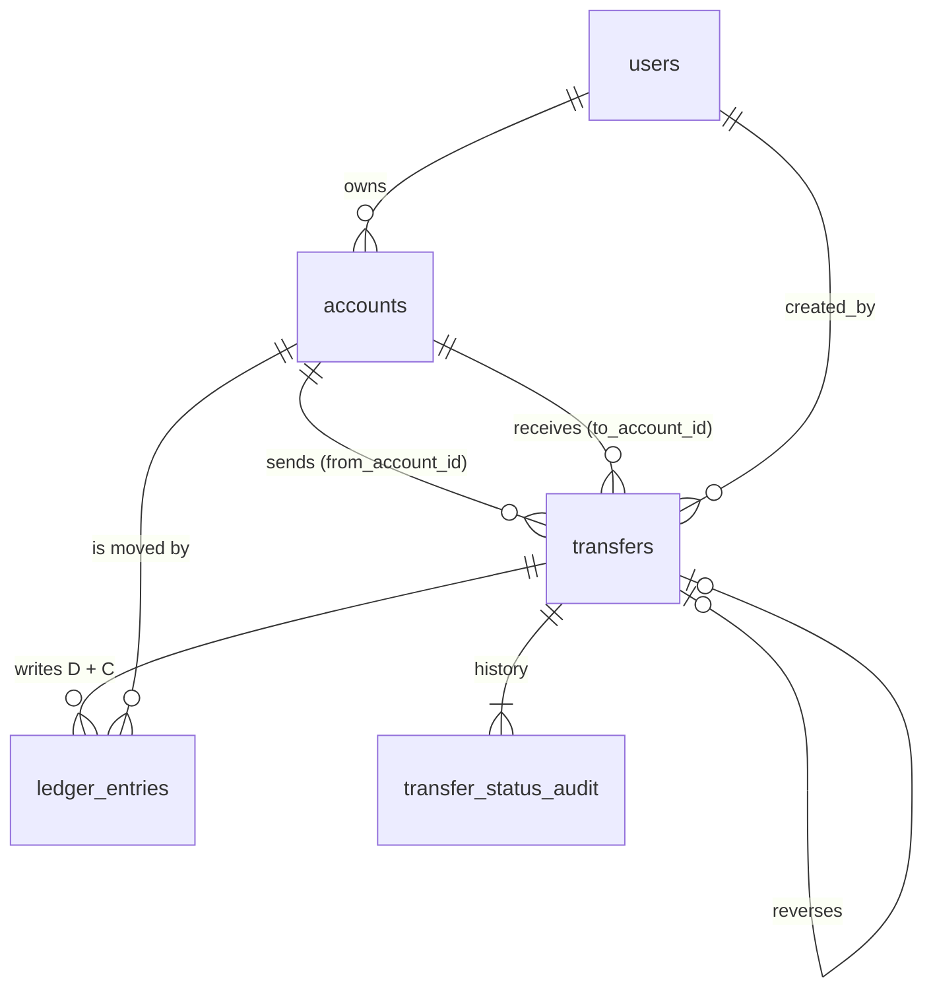

# Schema

Source of truth: `db/migrations/`. This page explains the nouns and how they relate.

## Nouns

| Table | One row is... | Notes |
| --- | --- | --- |
| `users` | a person | `kyc_status` stored, not enforced |
| `accounts` | a place money sits | `USER_WALLET` (owned by a user) or `SYSTEM` (`cash_in`, `cash_out`, `fee_revenue`). `balance` in paise |
| `transfers` | one money movement, the "why" | `type`, `status`, from/to account, `amount`. A `REVERSAL` points at the transfer it undoes |
| `ledger_entries` | one side of a movement, the "how much, where" | a `COMPLETED` transfer has exactly one `D` (debit, subtracts) and one `C` (credit, adds). Append-only |
| `transfer_status_audit` | one status change | first row has `old_status = NULL` |
| `idempotency_keys` | one POST we have seen | `(user_id, key)` unique; stores the response to replay |
| `job_locks` | one background job | locked with `FOR UPDATE NOWAIT` so runs never overlap |

## Cardinality

- user 1 — 0..n accounts (wallets). System accounts have no user.
- account 1 — 0..n transfers as sender, 0..n as receiver.
- transfer 1 — 0 or 2 ledger entries (0 while `HELD`/`REJECTED`, 2 once money moved).
- transfer 1 — 1..n audit rows.
- transfer 1 — 0..1 reversal (`reverses_transfer_id UNIQUE`).

## Rules the database enforces (not just the code)

| Rule | How |
| --- | --- |
| Money is exact | `BIGINT` paise everywhere; `bigint` in TypeScript |
| A wallet never goes negative | `CHECK (kind = 'SYSTEM' OR balance >= 0)`. System accounts may: `cash_in` goes negative as money enters |
| Amounts are positive | `CHECK (amount > 0)` on transfers and entries |
| Wallets have owners, system accounts don't | `CHECK ((kind = 'USER_WALLET') = (user_id IS NOT NULL))` |
| INR only | `CHECK (currency = 'INR')` |
| History is never rewritten | trigger on `ledger_entries` raises on UPDATE, DELETE, TRUNCATE |
| Reverse at most once | `UNIQUE (reverses_transfer_id)` |
| No double-processing of a retried POST | `UNIQUE NULLS NOT DISTINCT (user_id, key)` |

## Why the balance is stored AND derivable

`accounts.balance` gives a fast read and is the row we lock (`FOR UPDATE`) during a transfer.
The ledger is the proof: for every account, `SUM(C) - SUM(D)` must equal `balance`.
The nightly reconciliation (Step 5) checks exactly that.
